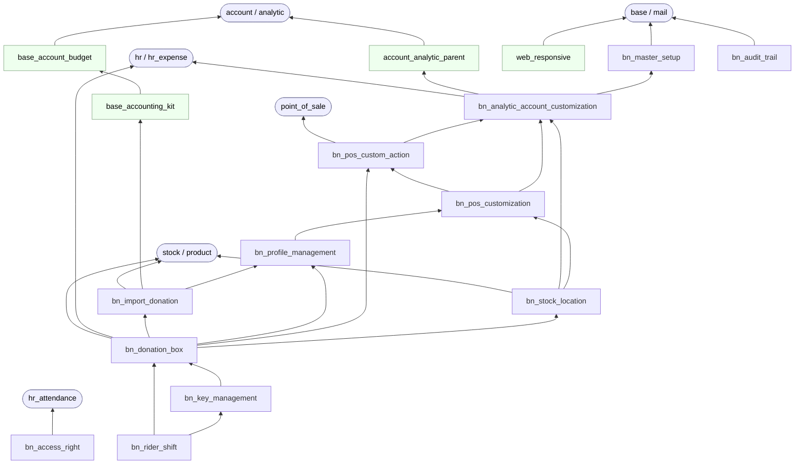
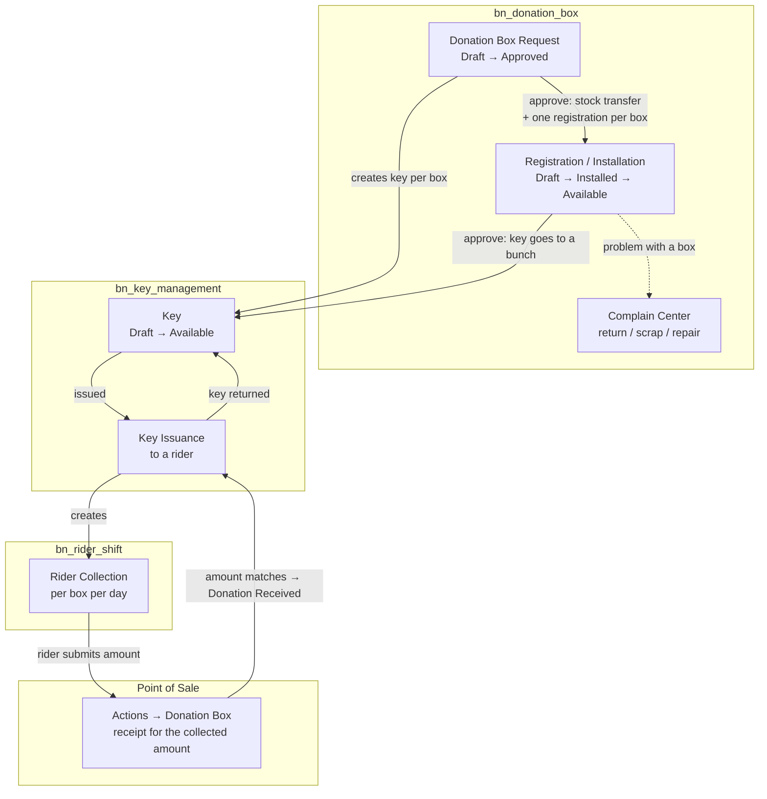

# SWIT Odoo: Custom Addons

Odoo 17 (Community) addons for **Saylani Welfare International Trust**.
The repository holds the organisation's own BytesNode modules (`bn_*`) plus
a few third-party community modules they build on.

All modules live in [`custom-addons/`](custom-addons). Add that folder to the
Odoo `addons_path`, restart Odoo, then *Apps > Update Apps List*.

## Modules (16)

### Custom modules (`bn_*`, 12)

| Module | Purpose |
| --- | --- |
| [`bn_master_setup`](custom-addons/bn_master_setup) | Shared master data: cities, banks, microfinance schemes, Qurbani days, SMS templates, ... |
| [`bn_analytic_account_customization`](custom-addons/bn_analytic_account_customization) | Branch / zone analytic accounts, employee ↔ branch link, mandatory analytic tags on journal entries |
| [`bn_pos_custom_action`](custom-addons/bn_pos_custom_action) | Generic **Actions** button and popups on the POS that other modules plug into; yearly receipt numbering |
| [`bn_pos_customization`](custom-addons/bn_pos_customization) | POS look & feel (receipt, partner editor, product widget) and "own shop only" record rules |
| [`bn_profile_management`](custom-addons/bn_profile_management) | Donor / Donee profile registration on `res.partner`, registration IDs, configurable profile types |
| [`bn_stock_location`](custom-addons/bn_stock_location) | Restricts each user to their allowed warehouses / locations |
| [`bn_import_donation`](custom-addons/bn_import_donation) | Imports online donations (Excel files or the website API) and posts the journal entries and stock moves |
| [`bn_donation_box`](custom-addons/bn_donation_box) | Donation box life cycle: request → installation → approval → complaint / return / scrap / repair |
| [`bn_key_management`](custom-addons/bn_key_management) | Keys of installed boxes, key bunches, issuing keys to riders and getting them back |
| [`bn_rider_shift`](custom-addons/bn_rider_shift) | Rider shifts and daily box collections, counterfeit notes, foreign currency, POS deposit of collections |
| [`bn_audit_trail`](custom-addons/bn_audit_trail) | Create / update / delete / view audit log for every model |
| [`bn_access_right`](custom-addons/bn_access_right) | Small access right adjustments on standard apps (HR, Attendance) |

### Third-party modules (4)

| Module | Source | Purpose |
| --- | --- | --- |
| [`base_accounting_kit`](custom-addons/base_accounting_kit) | Cybrosys | Full accounting kit for Community (reports, assets, PDC, ...) |
| [`base_account_budget`](custom-addons/base_account_budget) | Cybrosys | Budget management |
| [`account_analytic_parent`](custom-addons/account_analytic_parent) | OCA | Parent / child hierarchy for analytic accounts |
| [`web_responsive`](custom-addons/web_responsive) | OCA | Responsive web client |

These keep their original `README.rst`.

## Process flow diagrams

Each module README contains its process flow as a Mermaid diagram, which
GitHub renders as an image. PNG copies of every diagram, for documents and
presentations, are in [`docs/process-flows/`](docs/process-flows).

## Module dependencies

Arrows point from a module to the module it depends on. Standard Odoo apps are
shown with rounded boxes.

Installing `bn_rider_shift` pulls in the whole donation-box chain. `bn_audit_trail`,
`bn_access_right` and `web_responsive` are independent.

## Main business flow: donation boxes

The largest process in this repository runs across `bn_donation_box`,
`bn_key_management`, `bn_rider_shift` and the POS modules. Each module's
README has the detailed flow; this is the end-to-end picture.

## Other flows at a glance

- **Online donations** (`bn_import_donation`): Excel file or website API → donations →
  one grouped journal entry (+ stock picking for stockable products).
- **Profiles** (`bn_profile_management`): search by registration ID / CNIC / mobile →
  open or create Donor / Donee → *Register* assigns a registration ID.
- **Access**: `bn_stock_location` limits stock data to each user's warehouses and
  locations; `bn_pos_customization` limits POS shops, sessions and orders to their
  own user; `bn_analytic_account_customization` ties every employee to a branch
  analytic account.

## Deployment

GitHub Actions in [`.github/workflows`](.github/workflows) deploy over SSH:

| Branch | Environment |
| --- | --- |
| `main` | UAT |
| `pre_production` | Pre-production |
| `Development` | Development |

## Conventions for `bn_*` modules

- Author **BytesNode** (`https://bytesnode.com/`), license LGPL-3, menu category
  `BytesNode/<Module>`.
- Most modules define the same five groups: *Access Root Menu*, *User*,
  *Manager*, *Audit*, *Admin*.
- Workflow models in the donation-box family inherit `bn.workflow.mixin`
  (`bn_donation_box/models/bn_workflow.py`). Each button checks the user's
  group and the record's current status on the server, and status fields
  cannot be written directly. They change only through the workflow
  methods.
