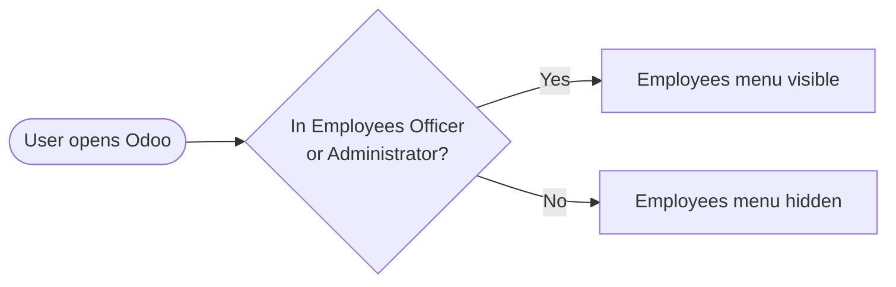

# Access Right (`bn_access_right`)

Small, central adjustments to access rights of standard Odoo apps, so they
are not scattered across feature modules.

**Depends on:** `hr_attendance`

## What it changes

| Item | Change |
| --- | --- |
| *Attendances / Officer* group | Moved to the *Human Resources / Attendances* category so it shows with the other HR rights |
| *Employees* root menu | Visible only to *Employees / Officer* and *Employees / Administrator*. Normal users no longer see the HR app |

## Flow

Add further standard-app access adjustments here.
