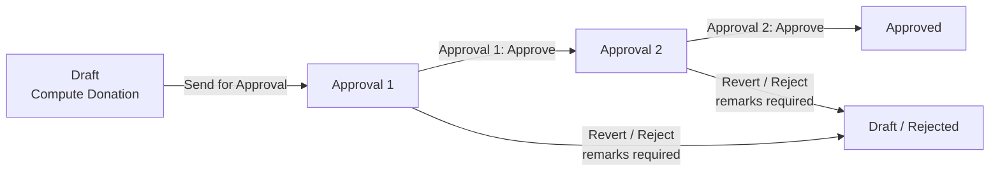

# Advance Donation (`bn_advance_donation`)

Donors pay in advance for future donations (goats, rations ...). The money
is kept on **receipts**, allocated to the lines of an **advance donation**,
and used later by Welfare, Microfinance or Livestock records
(`bn_advance_donation_syncing`).

## Process

- Lines are computed in Draft only, and not again once paid or disbursed.
- **Add Payment** allocates paid receipts of the same donor (FIFO).
- Receipts: cash / direct deposit are confirmed from Draft. A cheque is
  **deposited** (one journal entry) and stays **Pending** until Treasury
  confirms it (paid) or bounces it.
- POS: an advance donation product paid in cash gets its paid receipt when
  the order is saved (server side, linked to the order); paid by cheque,
  when Treasury clears the cheque.

## Security groups (category *Advance Donation*)

| Group | Can |
| --- | --- |
| *User (Menu)* | The app: donations, receipts, payments |
| *Approval 1* / *Approval 2* | Their approval step (each implies User) |
| Treasury (`bn_pos_cheque`) | Confirm / bounce a deposited cheque receipt |
