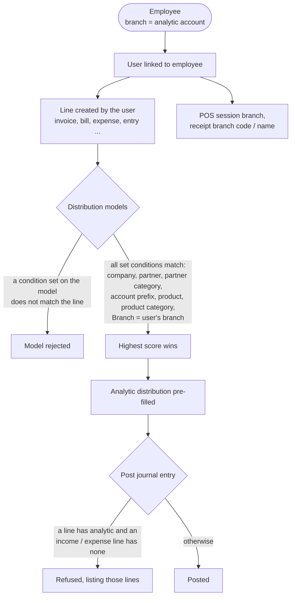

# Analytical Account Enhancement (`bn_analytic_account_customization`)

Uses analytic accounts as the trust's **branches, cities and zones**, ties
every employee (and so every user) to a branch, fills in the branch's
analytic account automatically through distribution models, and keeps
journal entries consistently analysed.

**Depends on:** `hr_expense`, `bn_master_setup`, `account_analytic_parent`

## What it adds

| Model | Change |
| --- | --- |
| `account.analytic.account` | `location_option_id` (Branch, Zone, City ...), `address`. Parent / child hierarchy comes from `account_analytic_parent` |
| `location.option` | Location types (Branch, Zone ...) |
| `sub.zone` | Sub zones under a zone analytic account (used by donation boxes, key bunches, rider schedules) |
| `hr.employee` | `analytic_account_id` = the employee's **branch**; `cnic_no` (format `XXXXX-XXXXXXX-X`, unique, **HR only**). The employee name gets the badge number appended at creation |
| `hr.employee.public` | The branch (not the CNIC) on the employee directory |
| `account.analytic.distribution.model` | Extra condition **Branch**; **several products** per model; chatter |
| `account.move` | Posting check (below) |

## Process flow



### Distribution models

Same rules as standard Odoo, plus two additions:

- **Branch**: a model with a Branch applies only to users whose employee
  belongs to that branch. A model without a Branch applies to everybody.
- **Products**: a model can list several products and applies to any of
  them. A model without products applies to every product.

A condition the model sets but the line does not meet **rejects** the model;
the most specific matching model wins. Choosing a Branch on the model form
puts it in front of every distribution line, replacing a branch chosen
before.

### Posting check

If any line of a journal entry carries an analytic distribution, every line
on an **income or expense** account must carry one too. Receivable /
payable, bank and tax lines are exempt. Each entry is checked on its own.

## Security groups

| Group | Can |
| --- | --- |
| *Access Root Menu* | See the *Master Setup > Analytical Accounting* menu (implied by every group below) |
| *User* | Read Location Options and Sub Zones |
| *Manager* | User + create / edit them |
| *Audit* | Read-only |
| *Administrator* | Everything, including delete |

Every internal user can **read** Location Options and Sub Zones (they are
picked on donation box, key bunch and rider screens). The menu is
*Master Setup > Analytical Accounting*; every group here gives access to the
Master Setup menu (only the menus the user's groups allow are shown).

## Server actions

`data/server_action.xml` (*Update Emplooyee Name | BN*, *Update User Name |
BN*: append the badge number to names) is **not loaded** by the manifest.
Databases that installed an earlier version may still have them under the
*Action* menu of employees / users; running them twice appends the number
twice.

## What changed in 17.0.1.2.0

| Problem in 17.0.1.1.0 | Fix |
| --- | --- |
| Distribution models without products never applied to lines with a product (almost every invoice / bill line) | Fixed |
| A condition that did not match only scored 0, so models for one partner / product / branch applied to other lines | Rejected, as in standard Odoo |
| Chatter fields (messages, activities) were compared as matching conditions | Ignored |
| Distribution models could not be created with one product id (Odoo's own code / imports) | Accepted |
| Changing the Branch on a distribution model crashed (`TypeError`) and branches piled up in the keys | Fixed |
| Every invoice / bill with an analytic account was refused at posting (its receivable / tax lines never have one) | Only income / expense lines must be analysed |
| Posting several entries at once checked them as one | Each entry on its own |
| Employees' CNIC readable by every user on the employee directory | HR only; removed from the directory |
| Re-entering an employee's own CNIC was refused; a real duplicate was accepted | Fixed |
| No menu group; Sub Zone / Location Option not readable outside this module's groups | Access Root Menu group; read for all internal users |
| Unused, unloaded `analytical.product.line` model file | Removed |

## Tests

`tests/test_analytic_account_customization.py`, run with:

```bash
odoo-bin -d <db> -u bn_analytic_account_customization --test-enable --test-tags /bn_analytic_account_customization --stop-after-init
```

Odoo's own analytic tests (`/analytic:TestAnalyticAccount`,
`/account:TestAccountAnalyticAccount`) also pass with this module installed.
