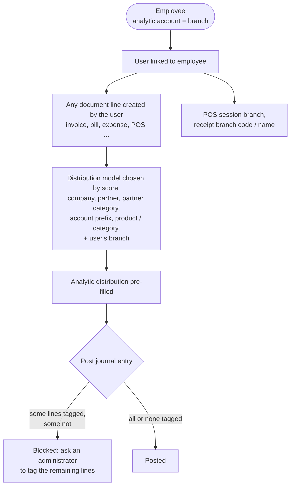

# Analytical Account Enhancement (`bn_analytic_account_customization`)

Uses analytic accounts as the trust's **branches, cities and zones**, ties
every employee (and so every user) to one of them, and makes sure journal
entries are tagged with them consistently.

**Depends on:** `hr_expense`, `bn_master_setup`, `account_analytic_parent`

## What it adds

| Model | Change |
| --- | --- |
| `account.analytic.account` | `location_option_id`, `address`. Parent / child hierarchy comes from `account_analytic_parent` |
| `sub.zone` | Sub zones under a zone analytic account (used by donation boxes, key bunches, rider schedules) |
| `location.option` | Location type master |
| `hr.employee` / `hr.employee.public` | `analytic_account_id` (the employee's branch) and `cnic_no` (validated `XXXXX-XXXXXXX-X`, unique). Employee name gets the badge number appended |
| `account.analytic.distribution.model` | Extra matching keys: analytic account, partner, partner category, account prefix, product category, several products. The current user's branch is always used for matching |
| `account.move` | On posting: if any line has an analytic distribution, **all** lines must have one |
| `analytical.product.line` | Product → analytic account mapping |

## Process flow

## Server actions

**Update Emplooyee Name | BN** and **Update User Name | BN** (Action menu
of the list view) append the badge number to the selected employees' and
users' names. Running them twice appends it twice.

## Security groups

*User*, *Manager*, *Audit*, *Admin* (category *Analytical Account Enhancement*).
