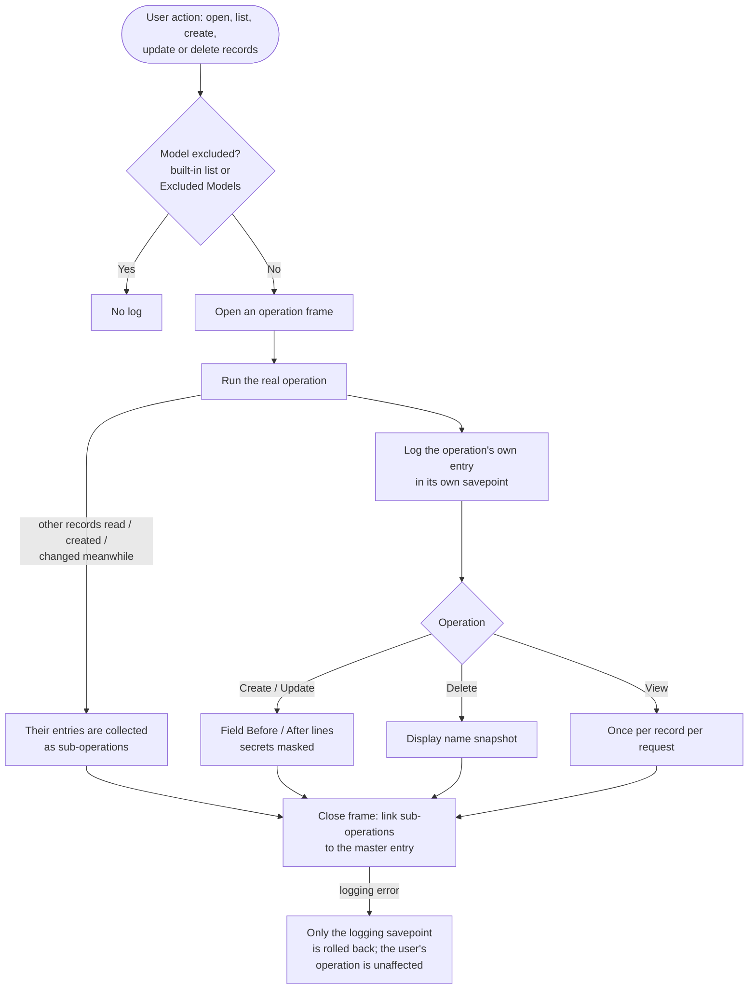
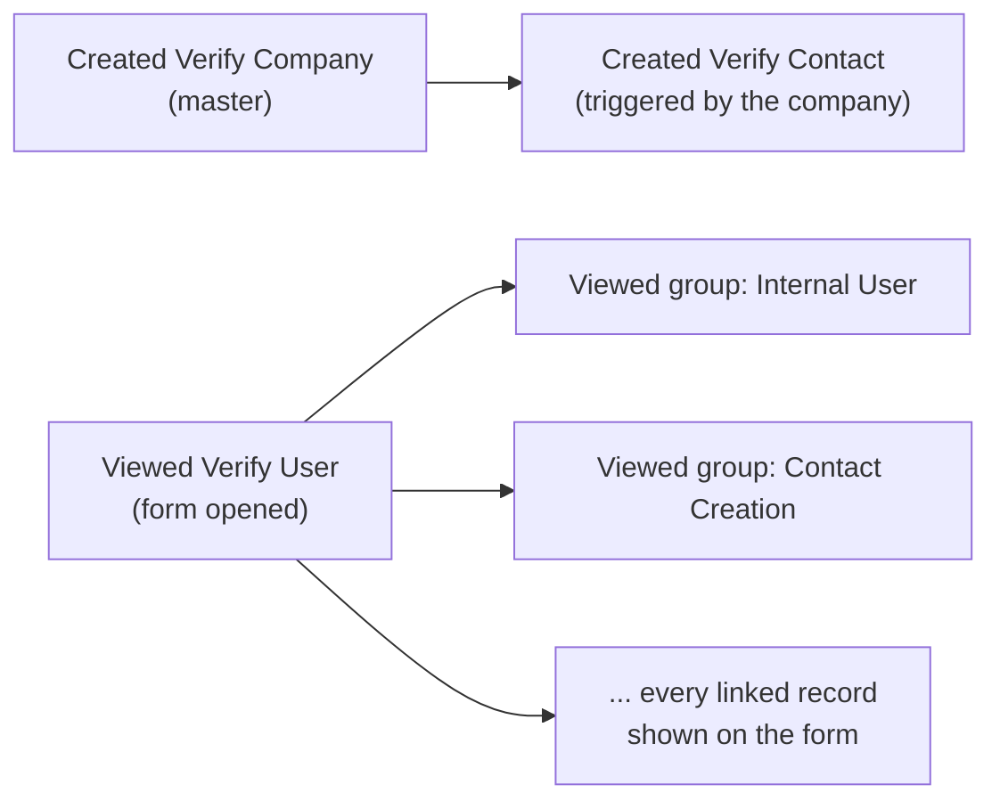

# Audit Trail (`bn_audit_trail`)

Audit trail for Saylani Welfare International Trust's Odoo 17 instance.
**Every standard and custom model is audited automatically** for Create,
Update, Delete and View, with field-level **Before / After** values, per
user, per date. Each operation is recorded as a **master entry** with
everything it read or changed in other records listed **under it**. This
shows when an action in one module modifies records of another.

**Depends on:** `base`, `web`

## Install / upgrade

1. Copy the `bn_audit_trail` folder into the Odoo addons path.
2. Restart Odoo.
3. *Apps > Update Apps List >* "Audit Trail" > **Install** (or **Upgrade**).

Upgrading from 17.0.2.2.0 or earlier is strongly recommended (see
*What changed in 17.0.2.3.0* below). New entries never store secrets, but
entries written by earlier versions may still hold passwords in plain
text. Mask them once after upgrading (back up the database first):

```sql
UPDATE audit_trail_log_line
SET old_value = CASE WHEN COALESCE(old_value, '') = '' THEN old_value ELSE '********' END,
    new_value = CASE WHEN COALESCE(new_value, '') = '' THEN new_value ELSE '********' END
WHERE field_name ~ '(^|_)(password|passwd|pwd|secret|token|apikey|api_key|totp|otp|private_key|signing_key|access_key|secret_key)(_|$)';
```

## Main models

| Model | What it is |
| --- | --- |
| `audit.trail.log` | One entry per audited create / update / delete / view of one record |
| `audit.trail.log.line` | One field's Before / After value of a create or update |
| `audit.trail.exclusion` | Models switched off by the user (*Audit Trail > Excluded Models*) |

Each log entry has a **Triggered By** link (`parent_id`) to the entry
that was running when it happened. All entries of one top-level operation
share an **Operation** reference (`operation_ref`).

## Process flow



### Example: what a single action produces



## Usage

1. **Audit Trail > Logs** opens on **Top-Level Operations**. Remove that
   filter to see every entry, or use *Triggered by Another Operation* to
   see only side effects.
2. Open an entry:
   - **Field Changes (Before / After)**: values of a create or update.
   - **Sub-Operations**: what this operation read, created, changed or
     deleted in other records. Each one can be opened in turn.
   - **Whole Operation**: every entry of the same top-level operation.
3. Useful filters: **Changes Only** hides views. **Internal (sudo)** shows
   what program code did with superuser rights on the user's behalf.
   **Today** and **Date** respect the user's time zone. Group by **User**,
   **Model**, **Action**, **Triggered By** or **Date**.
4. To stop logging a model: **Audit Trail > Excluded Models** > add the
   model. It takes effect immediately. Removing an exclusion is logged;
   the Audit Trail models cannot be excluded.

## Rules

- **Secrets are never stored.** Fields whose name contains password,
  secret, token, api key, TOTP / OTP or a private key, and fields nobody
  may read (`groups='.'`), are logged as `********`. You can still see
  that they changed.
- **Deleting log entries always leaves a trace.** Deleting an entry also
  deletes its sub-operations. Every deletion writes an *Audit log purge*
  entry with who deleted how many entries and from which dates.
- **History survives module uninstall.** The model name is stored on the
  entry, so uninstalling a module keeps its audit history.
- **The user's operation always wins.** Logging runs in its own
  non-flushing savepoint. If logging fails, only the log is lost: the
  user's operation, its error messages and the rest of the request are
  unaffected.

## Access control

| Group | Can |
| --- | --- |
| *Menu* | See the Audit Trail app menu (implied by every group below; not assigned alone) |
| *User* | Read **his/her own** activity only |
| *Audit* | Read **everybody's** activity and the Excluded Models |
| *Manager* | Audit + add / change / remove Excluded Models (removals are logged) |
| *Administrator* | Manager + delete (purge) log entries (every purge leaves a permanent entry). The seed Administrator is added automatically |

Assign them in *Settings > Users > Access Rights*, category *Audit Trail*.
On upgrade, members of the former *Viewer* group become *Audit* and the
former *Manager* group stays *Manager*; deleting log entries now needs
*Administrator*.

**The Audit Trail's own screens are not logged**, except deletions:
viewing the log, and creating or changing an exclusion, leave no entry;
**removing an exclusion** and **purging log entries** always do.

## Performance & volume

- Once warm, the exclusion check costs no SQL. A repeated view of the
  same record in one request costs no SQL either.
- Views are the largest share of the table. Opening a form also logs the
  linked records shown on it, as sub-operations. This is by design, so
  the trail shows what a screen touched.
- Use **Excluded Models** for a model that is too noisy, e.g. a detail-line
  model rewritten constantly.
- `audit.trail.log` grows indefinitely. Plan a periodic purge (it is
  traced) once real volumes are known.

## Known limitations

- **Batch operations:** when one operation covers several records (a
  list view, a write on many records), the linked records are filed under
  the **first** record of the batch. Odoo processes them together, so
  there is no way to tell which row they belong to. **Whole Operation**
  shows the full batch.
- **A record viewed twice in one request** is logged once, under the
  first operation that read it. Each new request (opening the screen again)
  logs it again.
- **Changes made with raw SQL** (some Odoo internals, `ondelete='cascade'`
  at database level) bypass the ORM and are not logged.

## What changed in 17.0.2.3.0

| Problem in 17.0.2.2.0 | Effect | Fix |
| --- | --- | --- |
| Passwords and 2FA secrets stored in plain text | Any Audit Viewer could read users' passwords | Values masked. Existing entries: run the SQL under *Install / upgrade* |
| Logging savepoint flushed the user's pending changes *outside* the savepoint | A real error such as a duplicate login was swallowed, and the request failed later with "current transaction is aborted". Chatter tracking was also finalised early | Non-flushing savepoints |
| Savepoint + flush on every read (12 extra statements for 3 reads) | Slower screens | No SQL for cached exclusions or repeated views |
| Exclusion changes not logged | Auditing could be switched off and on without a trace | Removing an exclusion is logged. Audit models cannot be excluded |
| Deleting log entries left no trace | History could be removed silently | Purge entry |
| Uninstalling a module deleted all its audit history (`ondelete='cascade'`) | Lost history | Kept |
| One-to-many / many-to-many changes showed "1 change command(s)" | Unreadable diff | Shows the resulting records |
| Flat list of entries | No way to see what an action did to other records | Master / sub-operation structure |
| `model.clear_caches()` (deprecated in 17) cleared every cache of the registry | Deprecation warnings, extra cache rebuilds | `registry.clear_cache()` |
| "Today" filter compared a local date with UTC | Off by the time-zone offset | Time-zone aware |

## Tests

`tests/test_audit_trail.py`, run with:

```bash
odoo-bin -d <db> -u bn_audit_trail --test-enable --test-tags /bn_audit_trail --stop-after-init
```
