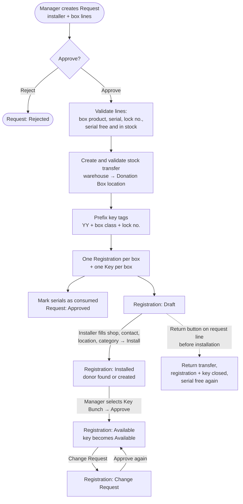

# Donation Box (`bn_donation_box`)

Manages the full life of a physical donation box: taking it out of the
warehouse, installing it at a shop, approving it for collection, and
handling complaints (missing, broken, robbed or returned boxes).

**Depends on:** `hr`, `stock`, `product`, `bn_stock_location`,
`bn_pos_custom_action`, `bn_profile_management`, `bn_import_donation`

## Main models

| Model | Menu | What it is |
| --- | --- | --- |
| `donation.box.request` | Donation Box > Request | A batch of boxes handed to an installer |
| `donation.box.request.line` | (lines of a request) | One box: product (box type), serial (Box No.), lock no., key tag |
| `donation.box.registration.installation` | Donation Box > Registration / Installation | One installed box at one shop / donor |
| `donation.box.complain.center` | Donation Box > Complain Center | A complaint raised against an installed box |
| `installation.category` | Configuration | Where the box is installed (shop, mosque, ...) |
| `donation.product.onhand` | Donation Products Inventory | Live on-hand report of box products for the user's branch |
| `bn.workflow.mixin` | (abstract) | Shared workflow guard, also used by `bn_key_management` |

It also adds:
- `product.template.is_donation_box`
- `stock.lot.lot_consume` (box is out in the field) and `is_not_return`
- `stock.warehouse.donation_box_picking_type_id` (per-warehouse "Donation Box" operation type)
- `res.company.donation_box_product` (product used for the POS receipt)

## Process flow

### Complaint flow

In every resolution path the registration is set to **Closed** and its
key is closed.

## Statuses

| Record | Statuses |
| --- | --- |
| Request | Draft → Approved / Rejected |
| Registration | Draft → Installed → Available ⇄ Change Request → Closed |
| Complaint | Draft → Process → Resolved / Not Recovered |

## Rules enforced on the server

- Status fields cannot be edited directly. They change only through the
  buttons, and each button checks the user's group and the current status.
- A serial can be in only one active request or registration at a time.
  Approval locks the serial rows (`SELECT ... FOR UPDATE`) so two
  simultaneous approvals cannot use the same box.
- The approval runs in one transaction. If the stock transfer cannot be
  validated, nothing is created.
- Lines of an approved request cannot be edited or deleted. Use the line's
  **Return** button (only before installation). Installed boxes go through
  the Complain Center.
- A box with an open complaint, or whose key is still with a rider, cannot
  be returned.

## Configuration

1. *Inventory > Products*: tick **Is Donation Box** on each box type. Boxes
   are tracked by serial.
2. *Inventory > Configuration > Warehouses*: set (or create) the **Donation
   Box Operation Type**. On install, a "Donation Box" customer location and
   operation type are created for the main warehouse.
3. HR employee tags *Installer*, *Donation Box Rider* and *Complain Officer*
   control who appears in the installer / rider / officer fields.
4. Server actions in the list view: **Bulk Install**, **Bulk Approved**,
   **Populate Lock No**.

## Security groups

*Access Root Menu*, *User* (install), *Manager* (approve, reject, change
request, resolve complaints, return, scrap, repair), *Audit*, *Admin*.
