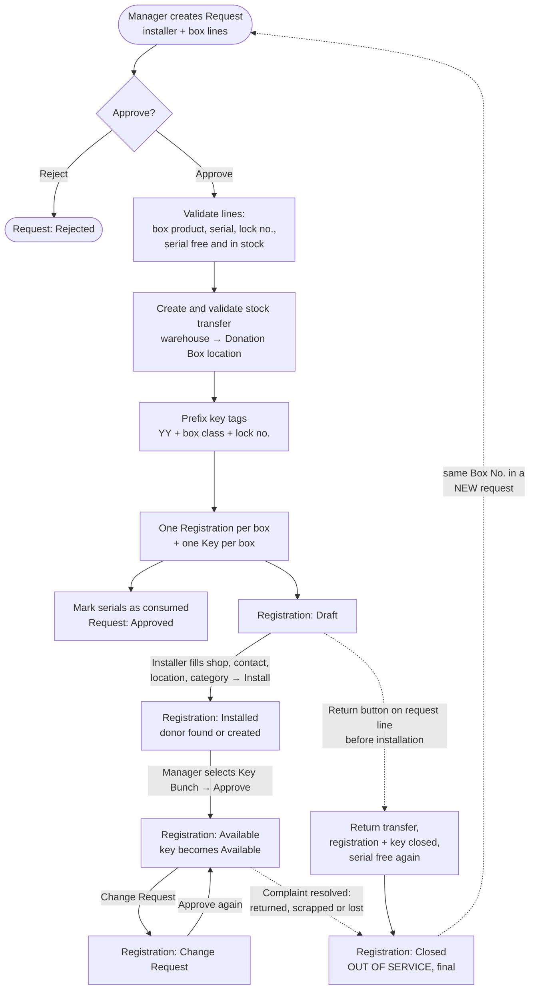
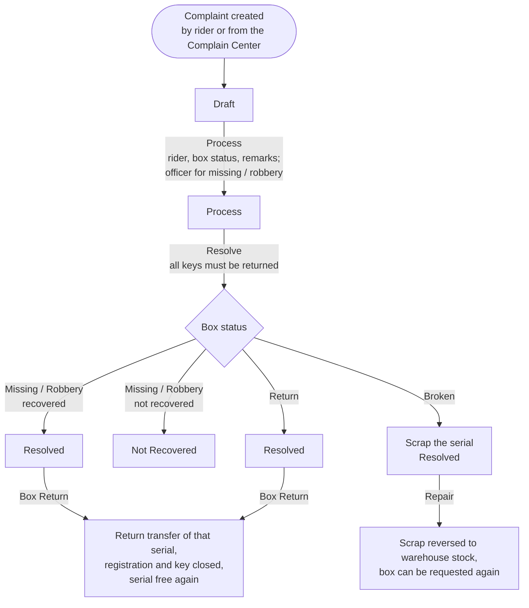

# Donation Box (`bn_donation_box`)

Manages the full life of a physical donation box: taking it out of the
warehouse, installing it at a shop, approving it for collection, and
handling complaints (missing, broken, robbed or returned boxes).

**Depends on:** `hr`, `stock`, `product`, `bn_stock_location`,
`bn_pos_custom_action`, `bn_profile_management`, `bn_import_donation`

## Main models

| Model | Menu | What it is |
| --- | --- | --- |
| `donation.box.request` | Donation Box > Request | A batch of boxes handed to an installer |
| `donation.box.request.line` | (lines of a request) | One box: product (box type), serial (Box No.), lock no., key tag |
| `donation.box.registration.installation` | Donation Box > Registration / Installation | One installed box at one shop / donor |
| `donation.box.complain.center` | Donation Box > Complain Center | A complaint raised against an installed box |
| `installation.category` | Configuration | Where the box is installed (shop, mosque, ...) |
| `donation.product.onhand` | Donation Products Inventory | Live on-hand report of box products for the user's branch |
| `bn.workflow.mixin` | (abstract) | Shared workflow guard, also used by `bn_key_management` |

It also adds:
- `product.template.is_donation_box`
- `stock.lot.lot_consume` (box is out in the field) and `is_not_return`
- `stock.warehouse.donation_box_picking_type_id` (per-warehouse "Donation Box" operation type)
- `res.company.donation_box_product` (product used for the POS receipt)

## Process flow

### Complaint flow

In every resolution path the registration is set to **Closed** and its
key is closed.

## A box taken out of service

A registration is **Closed** when its box is taken out of service: returned
to the warehouse (request line **Return** or complaint **Box Return**),
scrapped, or reported lost / robbed. Closed is **final**:

- The form shows an *Out of Service* ribbon and *Box Status* reads
  **Removed**.
- Nothing on it can be edited any more (only the chatter), from any screen,
  import or API. **Change Request** is not offered.
- No new complaint can be raised on it. Complaint actions (Process,
  Resolve, Scrap, Box Return) on a box another path already took out of
  service are refused.
- Its key is closed and cannot be issued.

To install the same box again, create a **new request** with that Box No.
It gets a new registration and a new key. Wherever only the Box No. is
known, the registration **in service** is used, never the closed one:
complaints raised by Box No., manual key issuance, the rider's
*Pending* button, foreign currency (FCB), counterfeit notes (CFB) and the
POS deposit.

While a *Return* complaint is resolved but its box not yet taken back
(Box Return), the box counts as having an open complaint.

## Statuses

| Record | Statuses |
| --- | --- |
| Request | Draft → Approved / Rejected |
| Registration | Draft → Installed → Available ⇄ Change Request; Draft / Available → Closed (final) |
| Complaint | Draft → Process → Resolved / Not Recovered |

## Rules enforced on the server

- Status fields cannot be edited directly. They change only through the
  buttons, and each button checks the user's group and the current status.
- A serial can be in only one active request or registration at a time.
  Approval locks the serial rows (`SELECT ... FOR UPDATE`) so two
  simultaneous approvals cannot use the same box.
- The approval runs in one transaction. If the stock transfer cannot be
  validated, nothing is created.
- Lines of an approved request cannot be edited or deleted. Use the line's
  **Return** button (only before installation). Installed boxes go through
  the Complain Center.
- A box with an open complaint, or whose key is still with a rider, cannot
  be returned.

## Configuration

1. *Inventory > Products*: tick **Is Donation Box** on each box type. Boxes
   are tracked by serial.
2. *Inventory > Configuration > Warehouses*: set (or create) the **Donation
   Box Operation Type**. On install, a "Donation Box" customer location and
   operation type are created for the main warehouse.
3. HR employee tags *Installer*, *Donation Box Rider* and *Complain Officer*
   control who appears in the installer / rider / officer fields.
4. Actions in the Registration list (*Action* menu): **Bulk Install** (User), **Bulk Approved** (Manager),
   **Populate Lock No**.

## Install / upgrade

On every install or upgrade (idempotent, `data/upgrade_hooks.xml`):
warehouses without a Donation Box operation type get one, and boxes
closed by earlier versions get Box Status *Removed*.

## What changed in 17.0.1.2.0

| Problem in 17.0.1.1.0 | Fix |
| --- | --- |
| A complaint could be raised on a closed registration | Refused |
| A closed registration stayed editable (contact person, key bunch ...) | Read-only, except the chatter |
| **Change Request** was shown on closed registrations and always failed | Removed; Closed is final |
| After a Box No. was reused, the manual key issuance, rider *Pending*, FCB, CFB and POS deposit could pick the **old closed** registration or key | They use the registration / key in service |
| A new complaint could be raised while a *Return* complaint waited for Box Return; Box Return then ran on a box already closed | Counted as open; actions on a box already out of service are refused |
| Box Status still read *Installed* after the box was removed | *Removed* |
| A fresh install left warehouses without the Donation Box operation type | Created on install / upgrade |

Tests covering the whole chain are in `bn_rider_shift/tests/test_closed_box.py`.

## Security groups

| Group | Menus | Buttons / actions |
| --- | --- | --- |
| *Menu* | The app icon (implied by every group, also by Key Management and Rider Shift access) | - |
| *User* | Request, Registration / Installation, Complain Center | Create requests, **Install**, **Process Complain**, *Bulk Install* |
| *Manager* | + Donation Products Inventory | + **Approve** / **Reject** request, line **Return**, **Approved**, **Change Request**, **Complain Resolved**, **Box Return**, **Repair**, *Bulk Approved*, *Populate Lock No* |
| *Audit* | All of the above, read-only | None |
| *Administrator* | + *Master Setup > Installation Category* | Everything, delete |

Buttons are shown only to the groups that may use them, and each action
checks the group on the server as well. *Bulk Install*, *Bulk Approved* and
*Populate Lock No* are in the **Action** menu of the Registration list.

A step's own group is enough to complete it: stock transfers, scraps, box
serials and keys changed by an approval, a return or a complaint are
handled by the system, so Donation Box users need no Inventory or Key
Management rights. They can read box serials (to pick a Box No.), keys,
key bunches and the related transfers.
