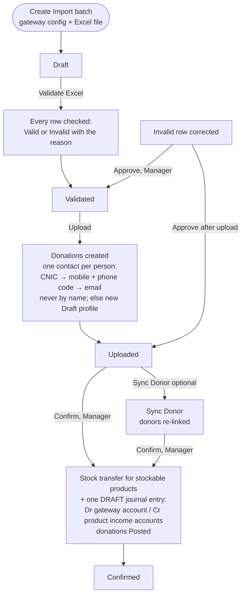
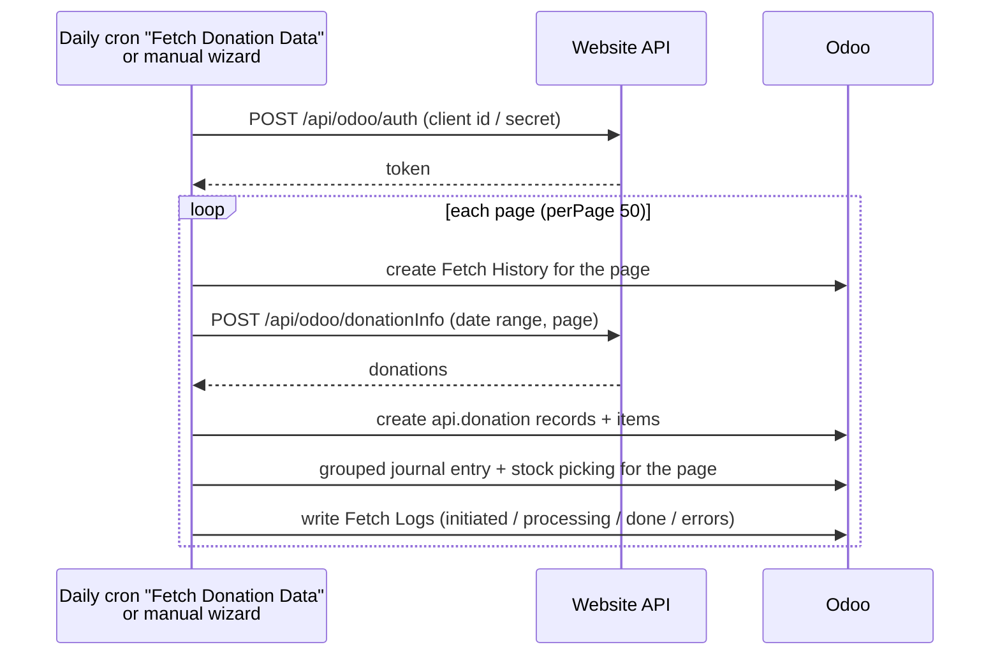

# Import Donation (`bn_import_donation`)

Brings online donations into Odoo, from either a payment gateway Excel
export or the website's donation API. It creates the donor profiles, then
posts one grouped journal entry and, for stockable products such as
Qurbani livestock, a stock transfer.

**Depends on:** `stock`, `product`, `base_accounting_kit`, `bn_profile_management`
(Python: `openpyxl`, `xlrd`)

## Main models

| Model | What it is |
| --- | --- |
| `gateway.config` | A payment gateway or API source: debit account, Excel column headers, product mapping, currency accounts, bank charges account, default donor, *Student Fees* |
| `header.type` | Logical column types used to map Excel headers |
| `import.donation` | One uploaded Excel file (an import batch) |
| `valid.import.donation` / `invalid.import.donation` | Rows that passed or failed validation. Invalid rows can be fixed and approved |
| `donation` | One imported donation (Draft / Posted), linked to a donor |
| `api.donation` (+ items, Qurbani order lines) | One donation fetched from the website API |
| `fetch.history` / `fetch.log` | One record per fetched API page, with its journal entry, picking and log lines |
| `api.donation.wizard` | Fetches donations from the API for a date range |

## Process flow: Excel import



### Row checks (Validate, and Approve of a corrected row)

A row is **invalid**, with the reason shown on it, when:

- the Transaction ID is missing, appears twice in the file, is already a
  valid line, or was **already imported** (by any batch);
- the amount is not a number or not greater than zero;
- the product (or course) is missing, not mapped in the gateway
  configuration, or its product has no income account;
- the mobile cannot be made a 10 digit number (`03001234567`,
  `+92 300 1234567` → `3001234567`), or the CNIC is not 13 digits;
- it has no name, mobile, CNIC or email.

Empty rows are ignored. Invalid rows keep the file's data. A Manager can
correct them in the list and **Approve**: the row is checked again and
becomes a valid line, or, once the batch is uploaded, a donation straight
away. A header with Position `-1` is found by its name in the file's first
row.

**Reset to Draft** works from Validated, Uploaded or Sync Donor (not from
Confirmed). It deletes the valid and invalid lines **and the donations** of
the batch (they are not posted yet), so the file can be validated again.
Donations of a batch follow the batch: they cannot be confirmed, reset or
deleted one by one.

## Process flow: website API



- The daily cron fetches the **last 3 days up to yesterday**. Donations
  already imported are skipped, so a missed run is caught up the next day.
  The wizard fetches the dates you choose.
- Payments whose status is not `success` are not stored, booked or
  delivered.
- Each item is mapped through the gateway's product lines, by
  `<donation type><item><type>` or else by the item name. The same mapping
  drives the journal entry and the stock transfer.
- Foreign amounts are converted at the rate of the **donation's date**.

### Journal entry of a page (Draft, for review by Accounts)

| Line | Amount |
| --- | --- |
| Cr income account of each item's product | gross item amount (what the donor gave) |
| Dr gateway account of the currency | gross − bank charges (what reaches the bank) |
| Dr **Bank Charges Account** of the gateway | bank charges (the gateway's fee) |

Without a Bank Charges Account the charges stay in the gateway debit, and
the donation says so. Every API donation shows its **Accounting** status:
*In Journal Entry*, *Partly in Journal Entry* or *Not in Journal Entry*,
with the reason (unmapped item, product without income account, currency
not active, no debit account). Filter **Missing from Journal Entry** lists
them. A currency that is not active in Odoo is never booked as company
currency.

Donors for API donations are linked afterwards with the **Create Partners
for Selected** action. It applies the same one-contact rule as the Excel
import. Donations without mobile and email get the gateway's **Default
Donor**. New donors are Draft profiles.

## Configuration

1. *Gateway Configuration*: create one per gateway. Set the **Debit
   Account**, the Excel **headers** (with their header type), the
   **product lines** (gateway product name → Odoo product) and optional
   **currency accounts**.
2. Each donation product needs an **income account**. Confirmation stops
   if one is missing.
3. A **Bank** journal must exist for the company.
4. For stockable products, set the warehouse / operation type on the
   import batch.
5. API access: *Settings > Companies > (company) > Donation API*: URL,
   Client ID and Client Secret. Only Import Donation *Administrator* and Settings
   administrators can see or change them.
6. Gateways that import student fees (SMIT, PIAIC): tick **Student Fees**
   (the Course column is used as the product). Set on upgrade for gateways
   named SMIT / PIAIC.
7. The API gateway ("Web API"): currency debit accounts, **Bank Charges
   Account** and **Default Donor**.

## Security groups

| Group | Can |
| --- | --- |
| *Menu* | See the app (implied by every group below) |
| *User* | Create batches, Validate, Upload, Sync Donor, Reset to Draft |
| *Manager* | User + approve invalid rows, Confirm, fetch from the API, create donors from API donations |
| *Audit* | Read-only, everything |
| *Administrator* | Everything, configuration, API credentials |

Confirm creates the stock transfer and the Draft journal entry as superuser,
so a Manager needs no Inventory or Accounting rights.

## What changed in 17.0.1.2.0

| Problem in 17.0.1.1.0 | Fix |
| --- | --- |
| The daily API fetch crashed every day (called on an empty record) | Runs |
| The API fetch read company fields no module defined | URL / Client ID / Secret on the company, Administrator only |
| The fetch wizard could not open on a new database (operation type data not loaded) | Loaded |
| **Approve** of an invalid row always crashed; invalid rows kept only the error, no data | Rows keep their data, can be corrected and approved, also after upload |
| Zero amounts, missing products and duplicates were dropped silently; one bad mobile aborted the whole validation | Every rejected row is listed with its reason |
| Donors matched **by name**: two people with the same name got each other's donations | CNIC → mobile + phone code → email, never by name |
| API donors: a donor without email was matched to **any** contact without email | Fixed |
| Reset to Draft left the donations behind, so the file could never be imported again | They are removed |
| The User group could not Validate / Upload; anyone could Confirm | Rights as in the table above |
| *Sync Donor* button only shown when it could not run; Confirm hidden after Sync Donor | Fixed |
| API: failed payments still moved stock | Not stored, no stock |
| API: an unmapped item or a product without income account was silently left out of the books (or crashed the fetch) | *Accounting* status and note on each donation |
| API: foreign amounts converted at the latest rate | Rate of the donation's date |
| API: unknown currency booked as company currency at rate 1 | Flagged, not booked |
| API: bank charges ignored by the journal entry | Charges expense, gateway net |
| Hard-coded gateway names (SMIT, PIAIC) and default donor registration ID | *Student Fees* and *Default Donor* on the gateway |
| Notes on the batch failed for users without an email address | Internal log notes |
| One-off repair actions (*Sync Donors for Existing Donations*, *Correct Records*) | Removed |

## Tests

`tests/test_import_donation.py` (Excel import, invalid rows, confirm, reset,
API fetch with a mocked website, donor matching), run with:

```bash
odoo-bin -d <db> -u bn_import_donation --test-enable --test-tags /bn_import_donation --stop-after-init
```
