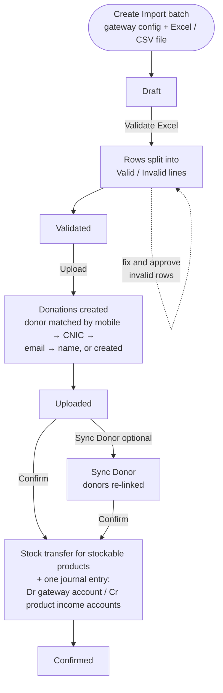
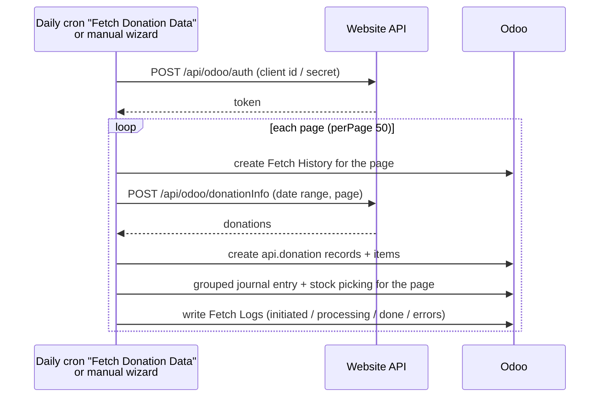

# Import Donation (`bn_import_donation`)

Brings online donations into Odoo, from either a payment gateway Excel
export or the website's donation API. It creates the donor profiles, then
posts one grouped journal entry and, for stockable products such as
Qurbani livestock, a stock transfer.

**Depends on:** `stock`, `product`, `base_accounting_kit`, `bn_profile_management`

## Main models

| Model | What it is |
| --- | --- |
| `gateway.config` | A payment gateway or API source: debit account, Excel column headers, product mapping, currency accounts |
| `header.type` | Logical column types used to map Excel headers |
| `import.donation` | One uploaded Excel file (an import batch) |
| `valid.import.donation` / `invalid.import.donation` | Rows that passed or failed validation. Invalid rows can be fixed and approved |
| `donation` | One imported donation (Draft / Posted), linked to a donor |
| `api.donation` (+ items, Qurbani order lines) | One donation fetched from the website API |
| `fetch.history` / `fetch.log` | One record per fetched API page, with its journal entry, picking and log lines |
| `api.donation.wizard` | Fetches donations from the API for a date range |

## Process flow: Excel import

**Reset to Draft** works from Validated, Uploaded or Sync Donor (not from
Confirmed). It deletes the valid and invalid lines so the file can be
validated again.

## Process flow: website API

Donors for API donations are created afterwards with the
**Create Partners for Selected** action on the selected API donations. The partners are
created in Draft in Profile Management.

## Configuration

1. *Gateway Configuration*: create one per gateway. Set the **Debit
   Account**, the Excel **headers** (with their header type), the
   **product lines** (gateway product name → Odoo product) and optional
   **currency accounts**.
2. Each donation product needs an **income account**. Confirmation stops
   if one is missing.
3. A **Bank** journal must exist for the company.
4. For stockable products, set the warehouse / operation type on the
   import batch.
5. API access uses the company's `url`, `client_id` and `client_secret`.
   These fields are not defined in this repository, so the module that adds
   them must also be installed.

## Security groups

*Access Root Menu*, *User*, *Manager*, *Audit*, *Admin*.
