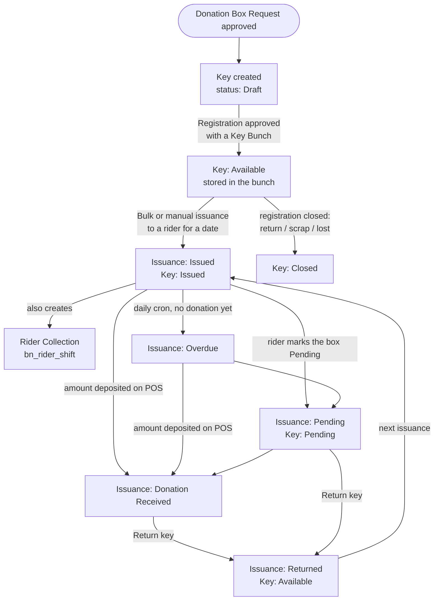
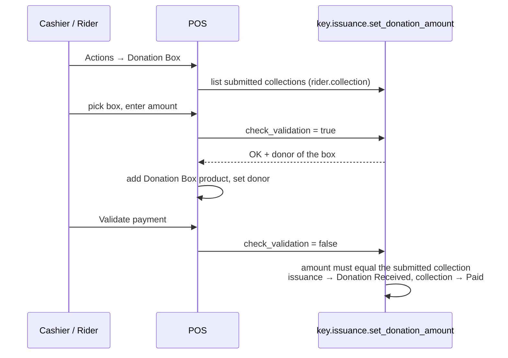

# Key Management (`bn_key_management`)

Tracks the physical key of every installed donation box: where the key is
stored (key bunch), which rider has it, and whether the rider brought back
the money and the key.

**Depends on:** `bn_donation_box`

## Main models

| Model | What it is |
| --- | --- |
| `key` | One key per box (serial). Created automatically when a donation box request is approved |
| `key.bunch` | A physical ring of keys (room / rack / shelf / slot, city, zone, sub zone). Max **50** open keys per bunch |
| `key.issuance` | A key handed to a rider for a given date |
| `bulk.key.issuance` (wizard) | Issue or return a whole bunch to / from a rider |
| `manual.key.issuance` (wizard) | Issue or return a single key |

It also extends the donation box registration with the key bunch, and
implements the key hooks used by `bn_donation_box` (create, activate,
change request, close, "can this box be released?").

## Process flow

### POS: recording the collected amount

Collections marked **CFB** (counterfeit notes) or **FCB** (foreign currency)
are posted to a "Counterfeit Donor" / "Foreign Currency Donor" partner and
their issuance is closed directly.

## Rules

- A key can be issued only when it is **Available** and has no other open
  issuance. Concurrent issue/return operations lock the key row.
- Keys and issuances cannot be deleted. They are closed by the workflow.
- A bulk issuance is refused while any key of the bunch is still out.
- Only issuances in *Donation Received* or *Pending* can be returned.
- Scheduled action **Hit Overdue Action | BN** (daily) turns *Issued*
  issuances with no donation into *Overdue*.

## Security groups

*Access Root Menu*, *User*, *Manager*, *Audit*, *Admin*.
