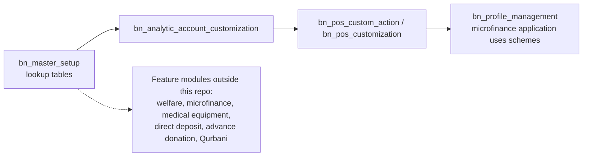

# Master Setup (`bn_master_setup`)

Shared master data (lookup tables) used by the other `bn_*` modules and by
the trust's feature modules (welfare, microfinance, medical equipment,
Qurbani, direct deposit, advance donation). It has no workflow of its own.
Other modules read these records.

**Depends on:** `base`, `mail`

## Masters

| Model | Used for |
| --- | --- |
| `city` | City list |
| `bank` | Bank list (POS provisional orders, direct deposit) |
| `direct.deposit.account.setup` | Account prefix for direct deposits (default data) |
| `disbursement.category` / `disbursement.application.type` | Welfare disbursement categories and application types (order type, product category, branches) |
| `microfinance.scheme` (+ lines, `loan.product.line`) | Microfinance schemes: prefix, daily / monthly installments, recovery days, products, security deposit and installment amounts |
| `medical.equipment.category` | Medical equipment with security deposit and approval flag |
| `advance.donation.category` (+ lines) | Product groups for advance donations |
| `product.master` (+ lines) | Product bundles (a product made of other products and quantities) |
| `qurbani.day`, `qurbani.hijri`, `chand.raat` | Qurbani days, Hijri year and Chand Raat date (default data) |
| `sms.template` | SMS message templates for donation notifications |

## Where it sits

## Security groups

*Access Root Menu*, *User*, *Manager*, *Audit*, *Admin*. Menus are under
*Master Setup*.
