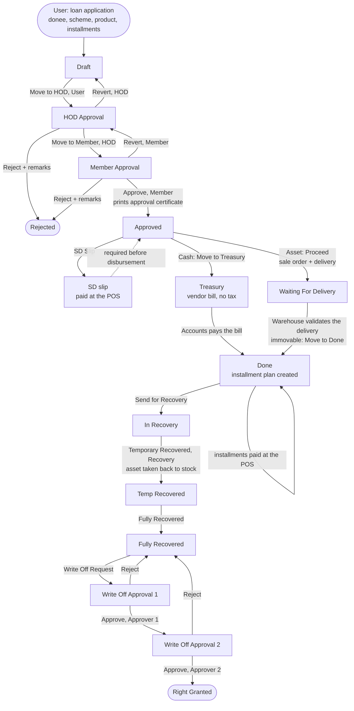

# Microfinance (`bn_microfinance`)

Interest-free loans to registered donees: as cash, or as
an asset (motorbike, rickshaw, sewing machine ...) repaid in monthly or
daily installments. Security deposits, installments and recoveries are
received at the Point of Sale.

**Depends on:** `bn_master_setup`, `bn_profile_management`, `bn_pos_order`,
`bn_advance_donation`, `bn_pos_custom_action`, `sale_stock`, `report_xlsx`

## Main models

| Model | What it is |
| --- | --- |
| `microfinance` | One loan application (applicant, scheme, product, amounts, documents, guarantors, family, status) |
| `microfinance.line` | One installment of the repayment plan (due date, amount, paid, cheque) |
| `microfinance.recovery.line` | Installments of a loan sent to recovery |
| `microfinance.installment` | A receipt: **SD slip** (security deposit) or installment receipt |
| `microfinance.pdc.line` | Post-dated cheques |
| `microfinance.scheme` / `.scheme.line` | Schemes and what they finance (cash, movable asset, immovable asset) |
| `loan.product.line` / `loan.product.installment` | Product of a scheme line: SD amount, installment amount, allowed numbers of installments |
| `security.offered` | Security types (guarantor, collateral ...) |
| `return.microfinance.product` (wizard) | Takes a recovered asset back into stock |

## Process flow



Every button checks the loan's status and the user's role on the server;
the status cannot be written directly.

- **Security deposit first:** a loan with a security deposit is only
  disbursed (Move to Treasury / Proceed) once its SD slip is **paid**.
- **Cash loans:** the vendor bill is for the loan amount (no purchase tax).
  When Accounts pays it, the loan is Done and its installments are created.
- **Asset loans:** Proceed checks the warehouse location really has the
  asset, then creates and confirms the sale order; validating its delivery
  completes the loan. Warehouse and Accounts staff need no Microfinance
  rights for this.
- **Post-dated cheques:** the PDC template columns are *Installment ID,
  Cheque Number, Bank Name, Amount, Cheque Date*. The upload only accepts
  installments of the loan itself.

## Point of Sale

POS cashiers (role *POS Action*) receive the security deposit, installments
and recoveries through the POS *Action* button (`bn_pos_custom_action`).
The POS installment payment checks the Shariah balance with the
`shariah.law` / `shariah.law.blocker` models, which are **not in this
repository**: that module must be installed for installment payments.

## Security groups

| Group | Can |
| --- | --- |
| *Access Root Menu* | See the app (implied by every tier) |
| *User* | Create applications, send them to the HOD, SD slips and receipts, Proceed / Move to Treasury / Move to Done, Send for Recovery |
| *Manager* | User + configuration under *Master Setup > Microfinance* |
| *Audit* | Read-only, everything |
| *Admin* | Everything, delete |

Roles (category *Microfinance Roles*, added on top of a tier; each implies
*User*): **HOD** (move to Member, reject, revert), **Member** (approve,
reject, revert to HOD), **Recovery** (recovery steps, write-off request),
**Write Off Approval 1 / 2**, and **POS Action** (POS cashiers: no access to
the app itself, only what the POS needs).

## What changed in 17.0.1.1.0

| Problem | Fix |
| --- | --- |
| Loans readable, editable and deletable by **every user, including portal** (access rules without group) | Rules per group |
| No status checks: a Draft loan could be approved, written off ... by anyone | Status + role checked on the server; status only through the buttons |
| Member could not Reject / Revert (buttons only shown at HOD Approval) | Shown at Member Approval |
| POS security deposit payment always failed ("schedule line not found") | Uses the SD slip |
| Loans disbursed without the security deposit received | Required |
| Cash loan bill added purchase tax (51,750 for a 45,000 loan) | No tax |
| Asset stock check searched a non-searchable field | Checks the quantity at the warehouse location |
| Asset loans needed Inventory rights for the User; the Recovery wizard and Temporary Recovered needed admin rights; warehouse / Accounts users could not complete loans | Fixed |
| Landlord CNIC field crashed when edited | Fixed |
| PDC upload read the cheque date from the Amount column and could write to another loan's installments | Fixed |
| Security type "Applications" button opened an invalid filter | Fixed |
| Line / receipt numbers overwrote any name given | Only when empty |
| Re-applying after a rejected loan was blocked (`bn_profile_management` checked a non-existing status) | Fixed |
| `bn_pos_order` could not be installed (list view referenced a field missing from it); `bn_pos_order`, `bn_advance_donation`, `bn_microfinance` lacked dependencies they use | Fixed |

## Tests

`tests/test_microfinance.py` (approval roles, cash loan, asset loan with
delivery / recovery / write off, PDC upload), run with:

```bash
odoo-bin -d <db> -u bn_microfinance --test-enable --test-tags /bn_microfinance --stop-after-init
```
