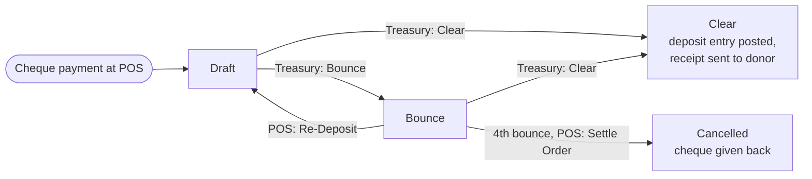

# POS Cheque (`bn_pos_cheque`)

Cheques received at the Point of Sale, followed by Treasury until the bank
pays them.

**Depends on:** `account`, `bn_closing_session`, `bn_pos_custom_action`,
`bn_pos_order`, `bn_sms_whatsapp`

## Process

- A cheque can bounce at most **4** times; after that it can only be settled.
- Clearing needs the **Deposit to Bank** (set from the POS closing screen or
  the list). The entry debits the bank's account and credits the
  **Cheque Clearing Account** (Accounting settings), or, when that is empty,
  the receivable account the session closing posted the cheque to.
  On upgrade from versions before 17.0.1.2.0 the setting is filled with the
  account the entry used to hard-code (id 6943), when it exists.
- Program modules add their own work through `action_clear`,
  `action_bounce`, `action_cancel` and `pos.order._prepare_pos_cheque_vals`:
  Advance Donation (receipts), Microfinance (PDC lines), Welfare (lines),
  Medical Equipment (security deposit), Livestock.

## Security groups (category *POS Cheque*)

| Group | Can |
| --- | --- |
| *Treasury* | Treasury > POS Cheque: deposit bank, Clear, Bounce |
| *Cheque / POS Action* | POS Cheques screen: list, Re-Deposit, Settle |

Every internal user can read cheques; nobody can create or delete them by
hand (they come from the POS).
