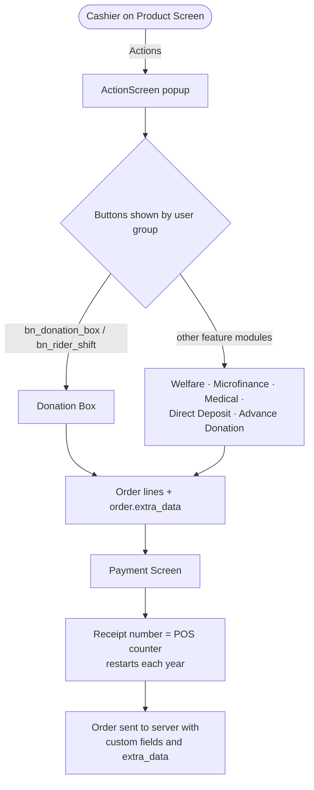

# POS Custom Action (`bn_pos_custom_action`)

Adds one **Actions** button to the Point of Sale product screen. It opens a
popup that other modules fill with their own buttons (Donation Box,
Welfare, Microfinance, Medical Equipment, Direct Deposit, Advance
Donation ...). Write the POS integration once here, and every feature
module reuses it.

**Depends on:** `point_of_sale`, `bn_analytic_account_customization`

## What it provides

| Piece | Purpose |
| --- | --- |
| `ActionButton` / `ActionScreen` (OWL) | The **Actions** button and its popup. Feature modules patch `ActionScreen` to add buttons |
| `ProvisionalPopup` | Shared popup for provisional orders (amount, service charges, bank, reference, case no.) |
| `ReceivingPopup` | Shared popup to receive an order by record / request number |
| `Order` patch | Sends `source_document`, `receive_voucher`, `pos_order_seq`, `qurbani` and `extra_data` (feature payloads) to the server |
| `pos.order` fields | Same fields stored on the order |
| `pos.session.analytic_account_id` | Session branch, taken from the cashier's employee analytic account |
| `res.company` product fields | Names of the products used by each POS feature (donation box, welfare, microfinance installment / deposit, medical deposit, home service) |
| `pos.config` counter / sequence | Receipt number per POS that restarts every year |
| Refund / reprint overrides | Templates of the standard buttons adjusted |

## Process flow

Each button is shown only to users in that feature's POS group. The
groups are checked with `user.hasGroup(...)` when the button loads. If a
feature module is not installed, its button stays hidden.

## Configuration

- *Point of Sale > Configuration > Settings*: **Counter** (starting receipt
  number for the POS).
- *Settings > Companies*: fill in the product names used by each POS
  feature.
