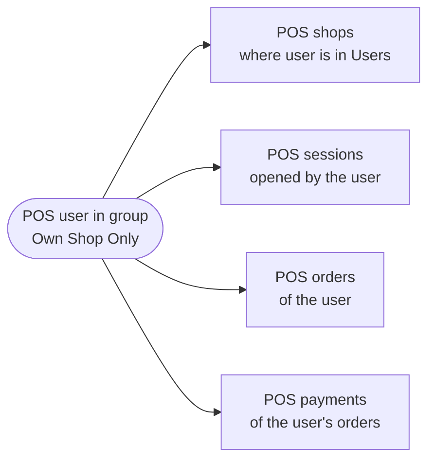

# POS Customization (`bn_pos_customization`)

Changes to the Point of Sale screens and access for the trust's cashiers.

**Depends on:** `bn_analytic_account_customization`, `bn_pos_custom_action`, `contacts`

## What it does

| Area | Change |
| --- | --- |
| Partner editor / list | Phone country code, CNIC, donor type (individual / corporate). New partners from POS are tagged **Donor** + **Individual** or **Corporate / Institute** |
| `res.partner.categories` | Comma-separated tag names, loaded in POS for display and search |
| `res.users` | `branch_code` / `branch_name` from the employee's analytic account, shown on the receipt |
| Receipt, receipt screen, payment screen | Custom layout (CSS / SCSS) |
| Product widget, category selector, ticket screen | UI adjustments |

## Access flow

Users in **Own Shop Only** see only their own shops, sessions, orders and
payments. Allowed users per shop are set in the `pos.config` **Users** field
added by `bn_pos_custom_action`.
