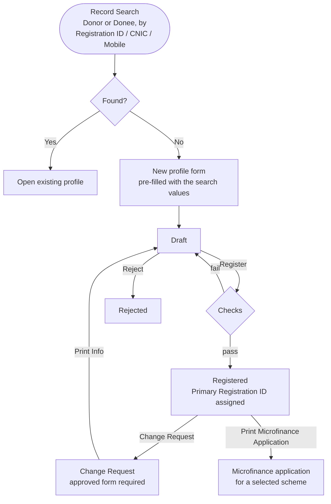

# Profile Management (`bn_profile_management`)

Turns Odoo contacts (`res.partner`) into registered **Donor** and **Donee**
profiles. A donee can be welfare, microfinance, medical or student. Each
registered profile gets a unique registration ID, CNIC and mobile number
are validated, and the profile types can be configured without code.

**Depends on:** `bn_pos_customization`

## Main models

| Model | What it is |
| --- | --- |
| `res.partner` (extended) | Personal data (CNIC, father / spouse, DOB, gender, family members, documents ...), status and registration IDs |
| `res.partner.category` (extended) | A tag can be a **profile type**. Its list, form and search fields and its notebook pages are configurable, and it gets its own menu |
| `profile.management.page` | Catalogue of form pages (General, Donation, Welfare, Microfinance, Medical) |
| `area` | Area master |
| `record.search` → `confirm.search` (wizards) | **Record Search**: find a profile before creating a new one |
| `microfinance.application.wizard` | Prints the microfinance application for a selected scheme |

Default tags created on install: Vendor, Donor, Donee, Individual,
Corporate / Institute, Welfare, Microfinance, Medical, Student, Employee,
Rider, Installer, Donation Box Rider, DB Donor.

## Process flow

### Checks on Register

- Individual donee: date of birth is required.
- Welfare / microfinance: the applicant must be at least 18 years old.
- Donee: the CNIC must be valid for at least one more year.
- No other registered **Donee** with the same CNIC or mobile, and no other
  registered **Donor** with the same mobile.
- If the same person is already registered as the other type (donor ↔
  donee), that registration ID is stored as the **Secondary Registration
  ID**.

### Registration ID format

| Profile | Format | Check digit |
| --- | --- | --- |
| Donee, individual | `YY-BY-SEQ-C` (BY = birth year) | 0 / 1 adult female / male, 4 / 5 minor female / male, 2 / 3 employee female / male |
| Donee, other | `YY-SEQ-C` | same as above |
| Donor | `YY-SEQ-C` | 6 individual, 7 corporate, 8 employee |

`YY` = registration year, `SEQ` = sequence `donee_profile_management` /
`donor_profile_management`.

## Configuring a profile type

*Profile Management > Configuration > Profile Types (Tags)*: tick **Is
Profile Type** and pick the list, form and search fields and the pages. A
menu and window action are created or updated automatically for that tag.

## Reports

Profile information sheet, microfinance application, user profile report
(Urdu font *Jameel Noori Nastaleeq* included).

## Security groups

*Access Root Menu*, *Edit Donor*, *User*, *Manager*, *Audit*, *Admin*, plus
record rules in `security/record_rule.xml`.
