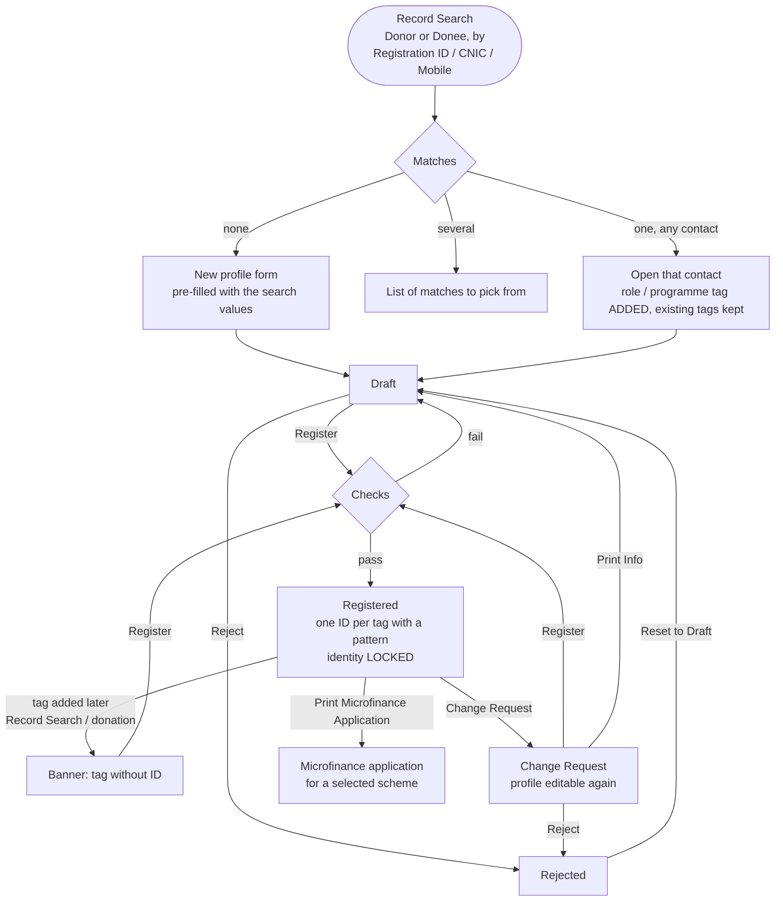

# Profile Management (`bn_profile_management`)

Turns Odoo contacts (`res.partner`) into registered **Donor** and **Donee**
profiles. A donee can be welfare, microfinance, medical or student. Each
registered profile gets a unique registration ID, CNIC and mobile number
are validated, and the profile types can be configured without code.

**Depends on:** `bn_pos_customization`

## Main models

| Model | What it is |
| --- | --- |
| `res.partner` (extended) | Personal data (CNIC, father / spouse, DOB, gender, family members, documents ...), status and registration IDs |
| `res.partner.category` (extended) | A tag can be a **profile type**. Its list, form and search fields and its notebook pages are configurable, and it gets its own menu |
| `profile.management.page` | Catalogue of form pages (General, Donation, Welfare, Microfinance, Medical) |
| `res.partner.registration` | The unique ID a contact received for one tag (one per tag) |
| `area` | Area master |
| `record.search` → `confirm.search` (wizards) | **Record Search**: find a profile before creating a new one |
| `microfinance.application.wizard` | Prints the microfinance application for a selected scheme |

Default tags created on install: Vendor, Donor, Donee, Individual,
Corporate / Institute, Welfare, Microfinance, Medical, Student, Employee,
Rider, Installer, Donation Box Rider, DB Donor.

## Process flow



### Checks on Register

- **Register** works from Draft or Change Request only. **Reject** works from
  Draft or Change Request; **Reset to Draft** from Rejected; **Change
  Request** from Registered. The status cannot be written directly.
- Individual donee: date of birth is required.
- Welfare / microfinance: the applicant must be at least 18 completed years
  old (age counts months and days).
- Donee: the CNIC must be valid for at least one more year.
- No other registered **Donee** with the same CNIC or mobile, and no other
  registered **Donor** with the same mobile. Only values that are filled in
  are compared, so two donees without a CNIC are not duplicates.
- If the same person is already registered as the other type (donor ↔
  donee), that registration ID is stored as the **Secondary Registration
  ID**.
- Welfare donees: needs the Welfare module (not in this repository).
  Without it, registration stops with a clear message. Re-registering never
  creates a second Welfare application.

### Registered profiles are locked

Once **Registered**, a profile's identity (name, CNIC, mobile, date of
birth, address, photo, documents, registration IDs ...) cannot be changed
from any screen, import or API until a **Change Request** is made. Free-text
notes (*Details*, *Reference / Remarks*) and the branch stay editable.
**Adding** a tag is allowed, for example when a registered donee also
donates. **Removing** a tag needs a Change Request. Code running as superuser
is not blocked.

Consequence: HR copies an employee's email and mobile onto their contact.
If that contact is a registered profile, HR must raise a Change Request first.

### Mobile numbers

Every contact's mobile must be **exactly 10 digits** (e.g. `3001234567`).
Longer numbers such as `03001234567` or `+923001234567` are rejected; earlier
versions silently cut them to 10 characters instead.

### One contact per person

A person has **one** contact; each role (Donor, Donee, Welfare, Student ...)
is a **tag** on it. Saving a second contact for the same person is refused,
with a message naming the existing contact and its IDs:

- same **CNIC** as any other contact, or
- same **mobile + phone code** as another profile contact (a contact with a
  profile-type tag). Sharing a mobile with a vendor or employee is allowed.

**Record Search** looks at every contact, whatever its tags. When the person
exists, it **adds** the role / programme tag to that contact and opens it.

Contacts duplicated before this rule existed are not merged automatically.
Use *Contacts > select both > Action > Merge* to merge them.

### A unique ID per tag

Each tag can define its own ID format under *Profile Management >
Configuration > Profile Types (Tags) > Unique Registration ID*:

| Token | Meaning |
| --- | --- |
| `{YY}` / `{YYYY}` | Registration year (26 / 2026) |
| `{BY}` | Birth year, 2 digits (needs the date of birth) |
| `{BY-}` | Birth year + `-`, for Individual contacts only |
| `{SEQ}` | Next number of the tag's own sequence, padded to *Number Length* |
| `{CHECK}` | Check digit, from the tag's *Check Digit Rule* |

Each pattern must contain `{SEQ}`. The form shows a live **Example**.
A sequence is created automatically for each tag.

Pre-configured on install / upgrade (only if empty, using the existing
sequences, so numbering and format continue unchanged):

| Tag | Pattern | Check digit | Example |
| --- | --- | --- | --- |
| Donee | `{YY}-{BY-}{SEQ}-{CHECK}` | 0/1 adult F/M, 4/5 minor F/M, 2/3 employee F/M | `26-90-00012-1` (organisation: `26-00012-1`) |
| Donor | `{YY}-{SEQ}-{CHECK}` | 6 individual, 7 organisation, 8 employee | `26-00012-6` |

**When IDs are created:** on **Register**, one ID for every tag of the
contact that has a pattern. The IDs appear on the profile's
**Registration IDs** tab. A tag added later to a registered contact (e.g. a
donor who now receives help) shows a banner and the **Register** button
again. If that role needs details the contact doesn't have yet, raise a
**Change Request**, complete them, then **Register**.

*Primary Registration ID* keeps the main ID (the Donee ID, otherwise the
Donor ID), so existing reports and integrations keep working. For a person
who is both, *Secondary Registration ID* is their Donor ID. IDs issued
before this version are recorded on the Registration IDs tab automatically
when the module is upgraded.

## Configuring a profile type

*Profile Management > Configuration > Profile Types (Tags)*: tick **Is
Profile Type** and pick the list, form and search fields and the pages. A
menu and window action are created or updated automatically for that tag.

## Reports

Profile information sheet, microfinance application, user profile report
(Urdu font *Jameel Noori Nastaleeq* included).

## Security groups

| Group | Can |
| --- | --- |
| *Access Root Menu* | See the Profile Management app (implied by every group below) |
| *User* | Create, edit, register, reject and raise change requests on profiles |
| *Manager* | User + configure profile types and Areas |
| *Audit* | Read-only |
| *Admin* | Everything, including delete |

## What changed in 17.0.1.2.0 - 17.0.1.3.0

| Problem in 17.0.1.1.0 | Fix |
| --- | --- |
| Users in the *Edit Donor* group could not log in (the rule hid their own contact) | Group and rule removed |
| Record Search on an existing person **replaced** all their tags and committed mid-request | Tags are added, nothing is committed early |
| Record Search for a Donor by mobile crashed (`phone_code_id`) | Fixed |
| Record Search with several matches crashed; with no donee type it did nothing | List of matches; clear messages |
| A registered profile could be completely rewritten (name, CNIC ...) | Locked until Change Request |
| Status could be changed in any order (reject a registered profile, register twice ...) | Status rules + Reject / Reset to Draft buttons |
| Donees without CNIC were blocked as duplicates of each other | Only filled-in values are compared |
| Age ignored month/day and was never refreshed (17-year-olds passed the 18+ check) | Exact, always current |
| Mobile numbers silently truncated to 10 characters | Rejected instead |
| Registering a Welfare donee crashed when the Welfare module is missing; re-registering created a second application | Clear message; one application |
| Hard-coded country id `177` in the Donor / Donee menus | `base.pk` |
| *Update Country Name* server action appended the phone code again on every run | Only once |
| The same person could exist as several contacts (one per role) | One contact per person; duplicates refused |
| Only Donor / Donee had an ID, in a hard-coded format | One ID per tag, pattern configured on the tag |

## Known gaps

- `microfinance.scheme` is no longer loaded by `bn_master_setup` (since
  29 Sep 2026), so the Microfinance Scheme fields of Record Search and the
  microfinance application wizard have no data to choose from.
- Profiles can still be created (e.g. imported) directly in status
  Registered, without the registration checks.

## Tests

`tests/test_profile_management.py`, run with:

```bash
odoo-bin -d <db> -u bn_profile_management --test-enable --test-tags /bn_profile_management --stop-after-init
```
