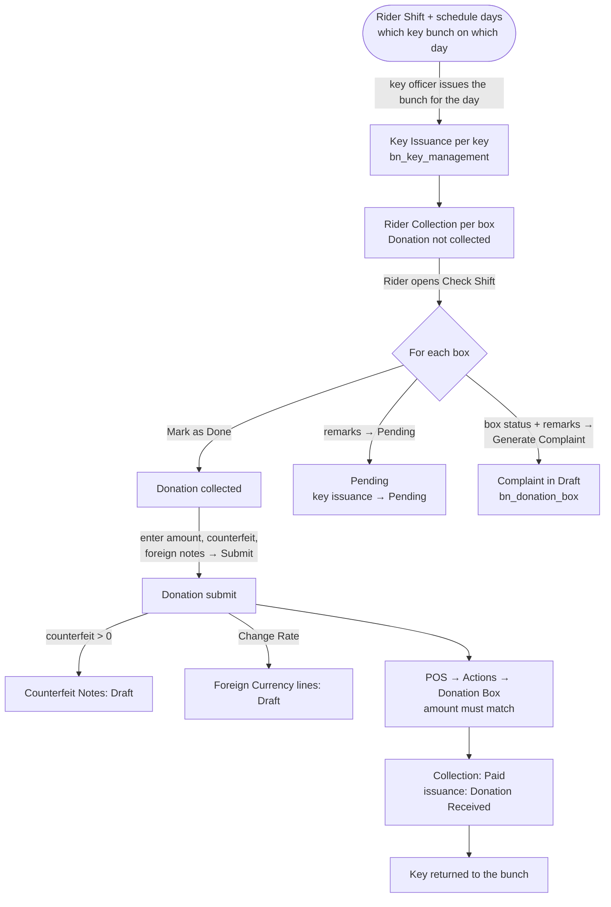
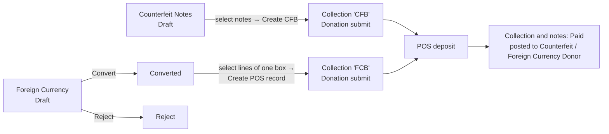

# Rider Shift (`bn_rider_shift`)

Plans the riders who visit installed donation boxes, records what each
rider collected from each box, and sends the money to the Point of Sale for
a receipt. It also handles counterfeit notes (**CFB**) and foreign currency
(**FCB**) found in the boxes.

**Depends on:** `bn_key_management`, `bn_donation_box`

## Main models

| Model | What it is |
| --- | --- |
| `rider.shift` | A rider's shift for a date range (Draft → Done) |
| `rider.schedule.day` | One planned day of a shift: city, zone, sub zone, key bunch, number of keys |
| `rider.collection` | One box to collect for one rider on one date. Created when the box's key is issued |
| `rider.schedule` / `rider.schedule.line` (wizard) | The rider's **Check Shift** screen: open collections to work on |
| `counterfeit.notes` | Counterfeit notes found in a box (Draft → Payment Received → Paid) |
| `foreign.currency` | Foreign notes found in a box (Draft → Converted / Reject) |
| `counterfeit.notes.wizard`, `foreign.currency.wizard` | Turn CFB / FCB lines into a POS collection |

## Process flow



### Counterfeit and foreign currency



## Collection statuses

Donation not collected → Donation collected → Donation submit → Paid,
or → Pending.

## Rules

- Only users in **Rider Collection / Edit Amount / Notes** can change the
  amount or counterfeit amount of a collection. Only users in
  **Foreign Currency Collection** can change a foreign currency amount.
- A pending box needs remarks and an active key issuance for that date.
- A generated complaint stays in Draft until the Complain Officer processes
  it in the Complain Center. A box taken out of service (registration
  Closed) cannot get a complaint.
- When a Box No. was reused after the box was taken out of service, *Pending*,
  FCB and CFB use the registration and key **in service**, never the closed
  ones (17.0.1.2.0; before, *Pending* failed and FCB / CFB could post to the
  old registration).

## Tests

`tests/test_closed_box.py` covers a box taken out of service and its Box No.
reused, across `bn_donation_box`, `bn_key_management` and this module:

```bash
odoo-bin -d <db> -u bn_rider_shift --test-enable --test-tags /bn_rider_shift --stop-after-init
```

The tests are `post_install`. Run them on a database where the modules are
already upgraded (or run the command twice): during the upgrade run itself,
`key.issuance.rider_collection_id` is not resolved yet, because
`rider.collection` is defined in this module.

## Security groups

*Access Root Menu*, *Rider Collection / Edit Amount / Notes*, *Foreign
Currency Collection*, *User*, *Manager*, *Audit*, *Admin*.
