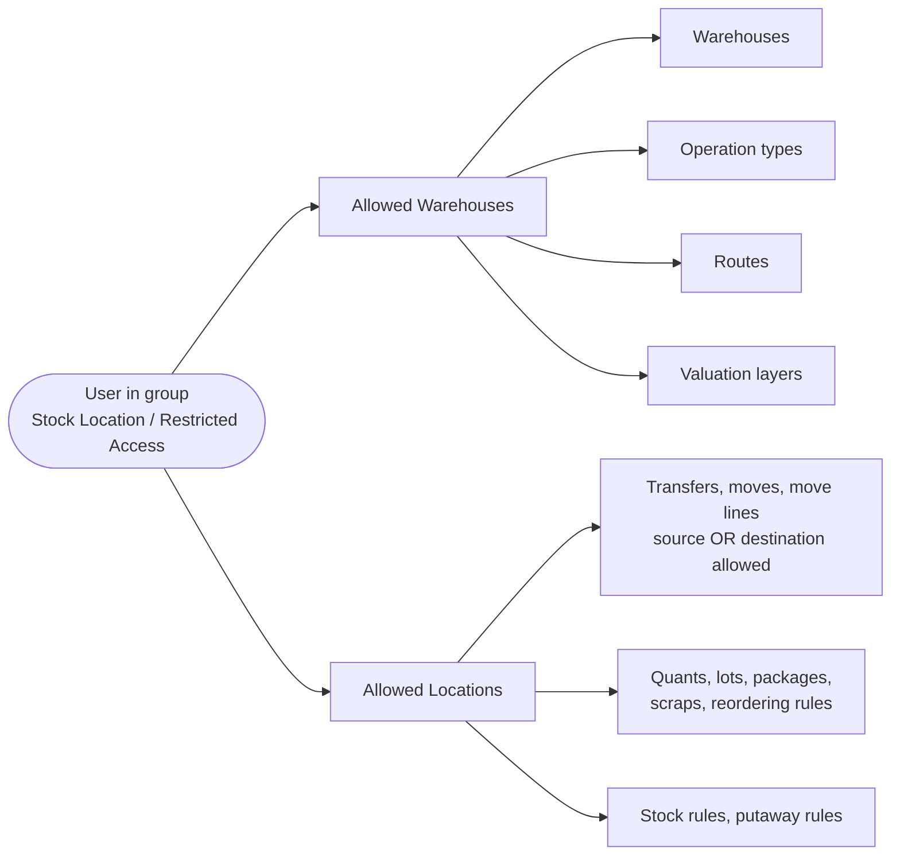

# Stock Location Customization (`bn_stock_location`)

Limits inventory data to the warehouses and locations each user is allowed
to work with, and adds a few location attributes.

**Depends on:** `stock`, `bn_pos_customization`, `bn_analytic_account_customization`

## What it adds

| Model | Fields |
| --- | --- |
| `res.users` | **Allowed Warehouses**, **Allowed Location**, **Allowed Categories** |
| `stock.location` | Analytic account (branch), location option, *Is Slaughter Location*, *Is Distribution Location* (Qurbani) |
| `stock.picking` | Computed allowed locations of the responsible user, used in view domains |
| `stock.quant` | `reason` for inventory adjustments |

## Access flow

Users in **Stock Location / Restricted Access** see only records that match
these rules. Other users are not restricted. The donation box module uses
the user's allowed warehouses for its default warehouse.
