# Welfare (`bn_welfare`)

Welfare applications of registered donees, approved in steps and paid at
the Point of Sale (one time or monthly).

## Process

```mermaid
flowchart LR
    D[Draft] -->|User: Complete| C[Completed]
    C -->|User: Send for Inquiry<br/>portal| SI[Send for Inquiry]
    SI --> I[Inquiry]
    I -->|User| CA[Committee Approval]
    CA -->|Committee: Move to HOD| H[HOD Approval]
    H -->|HOD, within limit| A[Approved]
    H -->|HOD, above limit| M[Final Approval]
    M -->|Member: Approve| A
    A -->|User: Create Recurring Orders, once| RC[Recurring]
    A & RC -->|all lines paid| X[Disbursed]
```

- Every step checks the status and the group in charge; Revert and Reject
  need the group of the current step (*Reject* also needs remarks).
- POS: lines are checked before the payment is validated and marked
  disbursed once the order is saved. One-time lines are paid when the
  welfare is Approved (HOD lines from HOD Approval on), recurring lines when
  it is Recurring.
- Only Draft or Rejected applications can be deleted.
- Delivery (In Kind) takes the stock of the company warehouse.

## Security groups (category *Welfare*)

*Welfare User*, *Welfare Committee*, *Welfare HOD*, *Welfare Member*,
*Welfare Manager*, *Marfat Officer*, *Welfare / POS Action* and the menu
groups. They were in a hidden category before 17.0.1.2.0 and could not be
given from the user form.
